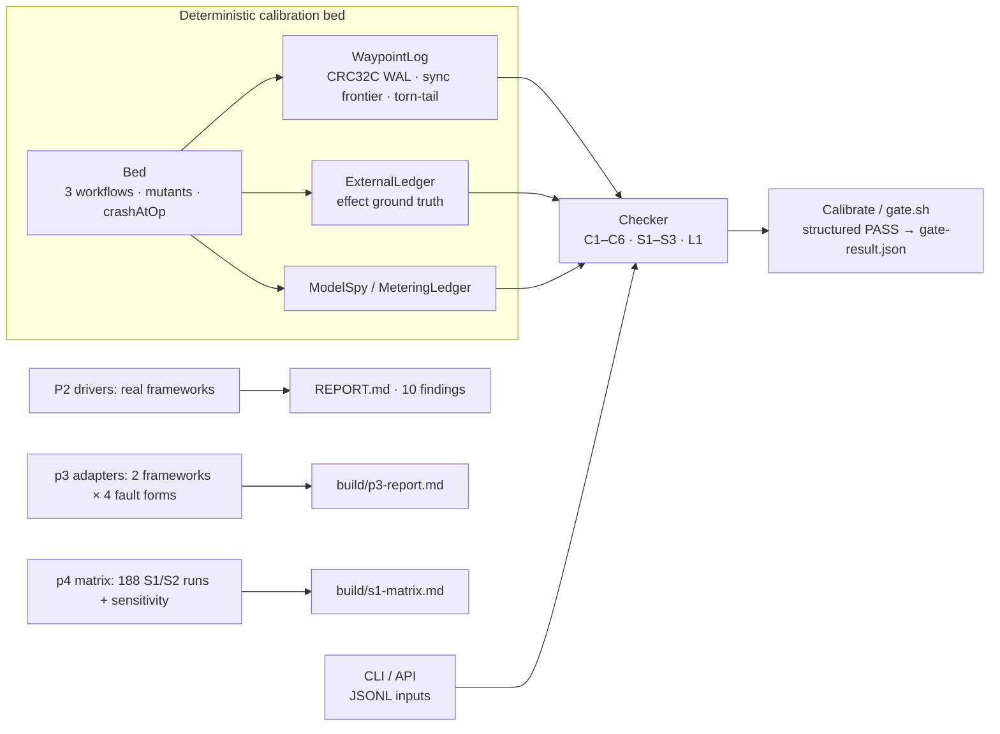

# Waypoint: recovery-contract checker for agent runtimes

<!-- publish:badge:start -->
[](LICENSE)
[](#quickstart)
[](CHANGELOG.md)
[](#scope)
[](https://github.com/zhaojie-tech/waypoint/actions/workflows/ci.yml)
<!-- publish:badge:end -->

<!-- publish:notice:start -->
> Status: `v0.1.0` research artifact, not production software. Public repository: https://github.com/zhaojie-tech/waypoint. 中文版: [`README.zh-CN.md`](README.zh-CN.md).
<!-- publish:notice:end -->

## Overview

Agent and workflow runtimes claim "durable execution", "resume from a checkpoint" and "exactly-once effects".
Waypoint turns those claims into a set of recovery contracts that can be executed, and audits a runtime against
them without relying on the runtime's own bookkeeping. The checker is first calibrated on a deterministic bed
with injected violations, and then pointed at real frameworks (langgraph4j, Spring AI Alibaba Graph, LangGraph
for Python).

Waypoint is a verification tool and a replication package. It does not run agents and is not production
infrastructure. Published numbers can be reproduced from the repository, and a framework claim is either
quoted from its documentation or marked as a gap.

## Quickstart

<!-- publish:quickstart:start -->
Prerequisites: JDK 17+ (JDK 21 is verified by CI; local runs at v0.1.0 used JDK 17), `bash` and `find`. The
gate needs no third-party runtime dependencies and no network access.

```bash
git clone https://github.com/zhaojie-tech/waypoint.git && cd waypoint   # or download the v0.1.0 archive
# from the repository root: one command, prints all numbers, exit code is the verdict
./gate.sh
```
<!-- publish:quickstart:end -->

A passing run prints `GATE: PASS`, a report sha256 and the metrics in the next section, then exits 0. The
section takes about 30 seconds. The gate run itself takes 5–10 s on a 4-core host, including compilation. Full
environment matrix and expected output: [`docs/reproducibility.md`](docs/reproducibility.md).

### Checking your own logs

```bash
./mvnw -B -q -DskipTests package
java -jar target/waypoint-0.1.0.jar check \
  --events examples/external-log/violation/events.jsonl \
  --ledger examples/external-log/violation/ledger.jsonl \
  --meta   examples/external-log/violation/meta.json
echo $?    # 1 = one C2 finding · use examples/external-log/clean/ for exit 0 · 2 = bad input
```

`check --format json` prints machine-readable findings. The Java facade (`waypoint.api.Waypoint`) and the
adapter contract (`unobservable`, `protocolObservable`) are described in
[`docs/adapter-guide.md`](docs/adapter-guide.md). `examples/external-log/` holds one clean example and one that
raises `C2`.

## Gate metrics

| Metric | Value (validated by `scripts/verify-docs.sh`) | Meaning |
|---|---|---|
| Recovery determinism | <!-- gate:determinism -->100/100<!-- /gate:determinism --> | repeated recovery of one crashed log gives an identical state hash |
| Torn-tail self-test | <!-- gate:tornTail -->9/10<!-- /gate:tornTail --> | a corrupted last record is rejected; the 9-record durable prefix survives |
| Baseline specificity | <!-- gate:baseline -->63 crash-runs, 0 contract violations<!-- /gate:baseline --> | deterministic operation-boundary crash points plus no-crash controls (composition in `docs/mutations.md`); a healthy bed must produce 0 findings |
| Mutation calibration | <!-- gate:mutants -->13/13<!-- /gate:mutants --> | every injected violation is caught on its target contract (catalogue in `docs/mutations.md`) |
| Gate verdict | <!-- gate:pass -->PASS<!-- /gate:pass --> | computed from numeric fields, not from report text; 5 negative controls must exit non-zero |
| Report sha256 | <!-- gate:sha -->09fa81ef83af05664b743b130849837af1186869fa11ba632a1c80e66f8b8f79<!-- /gate:sha --> | byte-level identity of the whole gate report |
| Version | <!-- gate:version -->0.1.0<!-- /gate:version --> | release this README describes |

The Chinese README carries the same markers and the CI job repeats the check, so the numbers cannot drift
between the documents. `build/gate-result.json` is the machine-readable source, and the gate's PASS predicate
is a numeric assertion over determinism, torn-tail survival, baseline runs and violations, and captured
mutants.

## Architecture



The checker takes its evidence from outside the runtime under test: the external effect ledger, the model spy
and a snapshot taken before recovery. The design, the crash model and the evidence grading are described in
[`docs/architecture.md`](docs/architecture.md).

## Contracts

Nine contracts plus one auxiliary log-integrity check. Each contract lists preconditions, an executable
assertion and observation points in [`docs/contracts.md`](docs/contracts.md), together with its implementation
status. The names C1–C6 follow the six properties formalized in the paper
[arXiv:2608.03836](https://arxiv.org/abs/2608.03836) (*Resume Means Resume*, Sajjad Khan, 2026-08); C3/C4 are
re-defined for this checker, and S1–S3 are additions for LLM workloads (the differences are listed in
`docs/contracts.md`).

| # | Contract | One-line assertion | Implementation status |
|---|---|---|---|
| C1 | Prefix continuation | recovery neither re-runs a completed step nor skips an unfinished one | full (the skip half needs `expectedSteps` from the adapter) |
| C2 | Effect exactly-once | per idempotency key: applied ≤ 1, and `STEP_STARTED` was durable before the effect | full (the ordering half becomes unobservable when the adapter cannot see it) |
| C3 | Fork determinism | children forked from one checkpoint have equal canonical traces | full (adapter supplies child events; otherwise unobservable) |
| C4 | Checkpoint validity | every `COMPLETED` in a snapshot has a `STEP_COMPLETED` in the log prefix | full (multi-entry snapshots are supported) |
| C5 | Consume-once | competing resumers do not both execute a pending step; the lease holder is honoured | full (requires executor and lease evidence; otherwise unobservable) |
| C6 | Recovery determinism | repeated recovery hashes are equal; step identities are stable across schedule orders | full (requires `replayHashes` and `orderTraces`) |
| S1 | Stream prefix and cancellation boundary | persisted chunks == configured K; replay emits exactly K; no upstream call after cancel | full (independent replay observation via `replayStream()`) |
| S2 | Compaction provenance | a durable summary is never re-generated by replay | full |
| S3 | Metering consistency | replay adds no metering entries; interruption class ∈ {COMPLETED, ESTIMATED, UNKNOWN} | conditional (real-usage anchoring is out of scope) |
| L1 | Log integrity (helper, not a contract) | no duplicate completion, no completion without a start, no duplicate `RUN_COMPLETED` | full |

An adapter that cannot observe a property declares it through `unobservable` or `protocolObservable=false`.
The checker then reports that contract as unobservable instead of counting it as a pass, which is what keeps a
PASS meaningful when an adapter covers only part of the log.

## Evidence

| Evidence grade | What was done | Where |
|---|---|---|
| Real process death | `SIGKILL` (exit 137) after the side effect was fsynced; a new process resumes | `p2/lab/langgraph_sigkill_driver.py` |
| Real concurrency | two processes resume the same run simultaneously | `p2/lab/lg_concurrent_resume.py` |
| Real frameworks | langgraph4j 1.9.5, Spring AI Alibaba Graph 1.1.2.4, LangGraph 1.2.16, pinned | `p2/`, `p3/` |
| In-process crash | deterministic crash-point injection (memory-side semantics) | P1 bed, P3 cells, P4 matrix |
| Real captured stream bytes | real GLM-5.3-flash SSE capture; byte-prefix persistence round-trip only | `p2/lab/real-llm-sse.txt` + p4 smoke |
| Mock property tests | deterministic mock model and compaction; contract and mutation properties | P1 gate, P4 S1/S2 |

P2 reported 10 findings against pinned framework versions: 4 gaps (C2 re-execution and the C5 concurrent
consume-once failure; none promoted to "violation" because the frameworks never promise exactly-once), 4 PASS
observations and 2 conditional observations. Per-finding quotes, pinned versions, evidence files and
reproduction commands are in [`p2/REPORT.md`](p2/REPORT.md).

## Reproduction

| Target | Command | Needs | Output |
|---|---|---|---|
| P1 core gate | `./gate.sh` | JDK 17+ | all gate metrics, `build/gate-result.json`, exit code |
| P4 S1/S2 matrix | `./p4/gate.sh` | JDK 17+ | cancellation-boundary matrix with active-run denominators and a sensitivity check → `build/s1-matrix.md` |
| P3 conformance | `./p3/gate.sh` | JDK 17+, Maven and network on the first run | 2 frameworks × 4 fault forms through the real checker → `build/p3-report.md`; exits 2 with a prerequisite message when dependencies are missing |
| P2 framework evidence | see `p2/lab/README.md` | Maven or Python venv, plus network | the 10 findings above (result files are tracked) |
| Everything, one shot | `make check` | JDK 17+ (Maven optional) | gate, p4 and the docs check; CI runs the same steps on JDK 17/21 |

Prerequisites, expected output and the parts that are not reproducible on this machine are listed in
[`docs/reproducibility.md`](docs/reproducibility.md).

## Status

| Phase | Scope | State |
|---|---|---|
| P1 | contracts, calibration bed, checker, mutation calibration | complete (gate PASS) |
| P2 | real-framework comparison: 10 findings, 3 frameworks tested, 2 pinned but untested | complete (evidence graded) |
| P3 | adapter prototype: real checker × 2 frameworks × 4 fault forms, coverage and unobservable items disclosed | complete |
| P4 | S1/S2 cancellation-boundary matrix with active denominators and sensitivity, plus the real-LLM SSE byte-prefix smoke | complete |
| v0.1.0 | structured gate verdict, crash semantics aligned with the docs, C1–C6/S1–S3 and L1 implementation, CLI/API, CI, packaging | this release |

Not tested, and recorded as such: power-loss semantics, distributed or multi-node runs, Diagrid Catalyst and
AgentScope Java (pinned coordinates, no runnable environment), and recovery engines driven by a real LLM.

## Limitations

1. The crash model discards unsynced memory and truncates torn tails. It does not simulate page-cache loss or
   `fsync` reordering, so all crash evidence is process-crash evidence, not power-loss evidence.
2. The core is single-node and single-process. The calibration bed is a single-threaded event loop; concurrency
   is modelled with an explicit lease/resumer protocol. P3's concurrent cells are real threads only where the
   framework exposes a resumable handle.
3. Adapter coverage is partial by construction. C2's ordering half, C4 snapshots, C5 lease evidence and S1
   replay need observations that many runtimes do not expose, so adapters have to declare them unobservable.
4. P2 covers 3 of the 5 pinned frameworks. Diagrid Catalyst (cloud) and AgentScope Java (session-store model,
   no per-step checkpoint) are recorded as untested.
5. The P4 figure of 0 violations is over active runs, not over all 188 runs. The matrix reports the active
   denominator (48/188 at v0.1.0) and a sensitivity section. A cancellation matrix in which the assertion
   cannot execute does not show correctness (`p4/README.md`).
6. The real-LLM smoke is a persistence round-trip of captured SSE bytes. It does not run the recovery engine
   with a real model and says nothing about real-model behaviour.
7. P3 adapters synthesize `ApplyRecord` metadata where the framework does not expose record indices, and the
   report marks those fields as synthetic. C2 conclusions from P3 are therefore limited to effect counts.
8. There is no performance work, no production hardening and no compatibility guarantee across versions.
9. JDK 21 is verified by CI (https://github.com/zhaojie-tech/waypoint/actions/runs/39228659294); local runs at v0.1.0 used JDK 17.
10. Do not run agents on this code. It is a checker and a replication package, not production-ready software.

## Citation

<!-- publish:citation:start -->
- This artifact: `Jie Zhao. Waypoint: a machine-checkable recovery contract for agent runtimes, v0.1.0 (2026).`
  Machine-readable metadata: [`CITATION.cff`](CITATION.cff). A Zenodo DOI is pending and will be added at
  publication.
- The paper behind C1–C6: `Sajjad Khan. Resume Means Resume. arXiv:2608.03836, 2026.`
  <https://arxiv.org/abs/2608.03836>
- Framework observations use pinned versions and quoted public documentation. URLs, section anchors and
  capture dates are listed in [`p2/REPORT.md`](p2/REPORT.md).
<!-- publish:citation:end -->

## Contributing

Contributions are welcome. [`CONTRIBUTING.md`](CONTRIBUTING.md) covers the
development setup, the commands that must pass (`./gate.sh`, `./mvnw -B -q verify`, `make check`), how to add a
contract or a mutant, and the norm for reporting findings about third-party frameworks (gap vs violation, a
verbatim quote with URL and pinned version, upstream reproduction first). The other community files are
[`CODE_OF_CONDUCT.md`](CODE_OF_CONDUCT.md), [`SECURITY.md`](SECURITY.md), [`SUPPORT.md`](SUPPORT.md),
[`THIRD_PARTY.md`](THIRD_PARTY.md) and [`CHANGELOG.md`](CHANGELOG.md).

## Scope

The documentation follows a few rules. Every published number has a reproduction path. A violation needs the
framework's own quoted promise. An unobservable check is not counted as a pass. Untested areas are labelled as
untested. If a claim in this repository breaks one of these rules, treat it as a bug and report it; `SECURITY.md`
gives the private channel.

## License

MIT. See [`LICENSE`](LICENSE).
