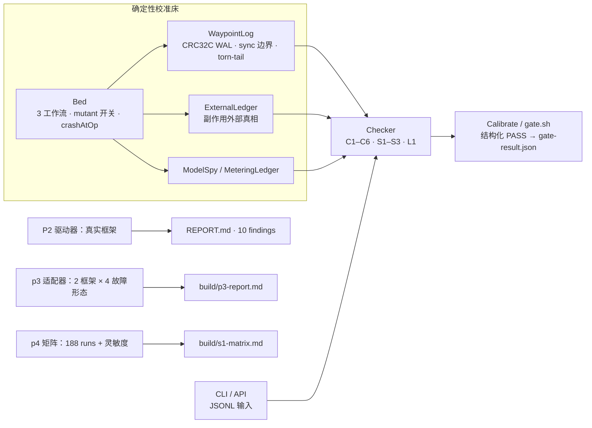

# Waypoint：面向 Agent 运行时的恢复契约检验器

<!-- publish:badge:start -->
[](LICENSE)
[](#快速开始)
[](CHANGELOG.md)
[](https://doi.org/10.5281/zenodo.23470564)
[](#范围)
[](https://github.com/zhaojie-tech/waypoint/actions/workflows/ci.yml)
<!-- publish:badge:end -->

<!-- publish:notice:start -->
> 状态：`v0.1.1` 研究制品，非生产软件。公开仓库：https://github.com/zhaojie-tech/waypoint。English: [`README.md`](README.md)。
<!-- publish:notice:end -->

## 概览

Agent 与工作流运行时经常声称具备 "durable execution"、"从 checkpoint 恢复" 和 "副作用恰好一次"。Waypoint
把这些声称写成一组可执行的恢复契约，并在不依赖运行时自身记账的情况下检验它。检验器先在带注入违例的确定性
校准床上完成校准，再用于真实框架（langgraph4j、Spring AI Alibaba Graph、LangGraph for Python）。

Waypoint 是检验工具和复现包。它不运行 agent，也不是生产基础设施。仓库里的数字可以复现；框架结论要么引用其
公开文档原文，要么标记为 gap。

## 快速开始

<!-- publish:quickstart:start -->
环境要求：JDK 17+（JDK 21 已由 CI 验证；v0.1.1 的本地运行使用 JDK 17）、`bash`、`find`。闸门不依赖第三方
运行时库，也不需要联网。

```bash
git clone https://github.com/zhaojie-tech/waypoint.git && cd waypoint   # 或下载 v0.1.1 归档
# 在仓库根目录；一条命令打印全部数字，exit code 即结论
./gate.sh
```
<!-- publish:quickstart:end -->

通过时会打印 `GATE: PASS`、report sha256 和下一节的指标，并以 0 退出。整节大约 30 秒。4 核机器上闸门含编译约
5–10 秒，检验器本身远小于 1 秒。完整环境矩阵与预期输出见 [`docs/reproducibility.md`](docs/reproducibility.md)。

### 检验自己的日志

```bash
./mvnw -B -q -DskipTests package
java -jar target/waypoint-0.1.1.jar check \
  --events examples/external-log/violation/events.jsonl \
  --ledger examples/external-log/violation/ledger.jsonl \
  --meta   examples/external-log/violation/meta.json
echo $?    # 1 = 一条 C2 finding · 用 examples/external-log/clean/ 则 exit 0 · 2 = 输入/参数错误
```

`check --format json` 输出机器可读 findings。Java 门面（`waypoint.api.Waypoint`）与适配器义务
（`unobservable`、`protocolObservable`）见 [`docs/adapter-guide.md`](docs/adapter-guide.md)。
`examples/external-log/` 提供一个 clean 示例和一个会触发 `C2` 的示例。

## 闸门指标

| 指标 | 数值（由 `scripts/verify-docs.sh` 校验） | 含义 |
|---|---|---|
| 恢复确定性 | <!-- gate:determinism -->100/100<!-- /gate:determinism --> | 同一崩溃日志重复恢复，状态哈希全等 |
| Torn-tail 自检 | <!-- gate:tornTail -->9/10<!-- /gate:tornTail --> | 损坏的末记录被拒绝，9 条 durable 前缀完整存活 |
| 基线特异性 | <!-- gate:baseline -->63 crash-runs, 0 contract violations<!-- /gate:baseline --> | 确定性操作边界崩溃点 + 无崩溃对照（构成见 `docs/mutations.md`）；健康床必须产生 0 条 finding |
| Mutation 校准 | <!-- gate:mutants -->13/13<!-- /gate:mutants --> | 每个注入违例都在目标契约上被捕获（清单见 `docs/mutations.md`） |
| 闸门结论 | <!-- gate:pass -->PASS<!-- /gate:pass --> | 由数值字段计算，不依赖报告文本；5 类退化必须 exit 非 0 |
| 报告 sha256 | <!-- gate:sha -->09fa81ef83af05664b743b130849837af1186869fa11ba632a1c80e66f8b8f79<!-- /gate:sha --> | 整份闸门报告的字节级身份 |
| 版本 | <!-- gate:version -->0.1.1<!-- /gate:version --> | 本 README 对应的发布版本 |

中文与英文 README 使用同一组标记，CI 也重复这项检查，数字不会在文档之间漂移。机器可读事实源是
`build/gate-result.json`；PASS 判据是对确定性命中数、torn-tail 存活、基线 runs/violations 和 mutants 捕获数
的数值断言。

## 架构



检验器的证据来自被检验运行时之外：外部副作用账本、model spy，以及恢复前的快照。设计、崩溃模型与证据分级见
[`docs/architecture.md`](docs/architecture.md)。

## 契约

9 条契约加 1 条辅助日志完整性检查。每条契约在 [`docs/contracts.md`](docs/contracts.md) 中列出前置条件、可执行
断言、观测点和实现状态。C1–C6 的名称沿用论文 [arXiv:2608.03836](https://arxiv.org/abs/2608.03836)
（*Resume Means Resume*, Sajjad Khan, 2026-08）中的六条性质；C3/C4 是按本检验器重新定义的版本，S1–S3 是面向
LLM 场景的补充（差异见 `docs/contracts.md`）。

| # | 契约 | 一句话断言 | 实现状态 |
|---|---|---|---|
| C1 | 前缀续跑 | 恢复不重跑已完成 step、不跳过未完成 step | full（skip 半条需适配器提供 `expectedSteps`） |
| C2 | 副作用恰好一次 | 同一幂等键生效次数 ≤ 1，且 `STEP_STARTED` 先于副作用落盘 | full（顺序半条在适配器不可观测时转为 unobservable） |
| C3 | 分叉确定 | 同一检查点分叉的子 run canonical trace 相同 | full（适配器导出子事件；缺则不可观测） |
| C4 | 检查点自洽 | 快照中每个 `COMPLETED` 在日志前缀内都有 `STEP_COMPLETED` | full（支持多状态快照） |
| C5 | 消费一次 | 竞争恢复实例不同时执行 pending step；lease 持有者优先 | full（需 executor 与 lease 证据；缺则不可观测） |
| C6 | 恢复确定 | 重复恢复哈希全等；step 标识跨调度顺序稳定 | full（需 `replayHashes` 与 `orderTraces`） |
| S1 | 流式前缀与取消边界 | 持久化 chunk 数 == K；重放恰发射 K；取消后不再调用上游 | full（用 `replayStream()` 做独立重放观测） |
| S2 | 压缩溯源 | 摘要已持久化时重放不得重新生成摘要 | full |
| S3 | 计量一致 | 重放零新增计量分录；中断分类 ∈ {COMPLETED, ESTIMATED, UNKNOWN} | conditional（真实 usage 锚定不在范围内） |
| L1 | 日志完整性（辅助检查，不是第 10 条契约） | 无重复完成、无 STARTED 的完成、无重复 `RUN_COMPLETED` | full |

适配器无法观测某条契约时，通过 `unobservable` 或 `protocolObservable=false` 声明。检验器会把该契约记为
不可观测，而不是记为通过。适配器只覆盖部分日志时，PASS 仍然有意义，靠的就是这条规则。

## 证据

| 证据等级 | 实际做了什么 | 位置 |
|---|---|---|
| 真实进程死亡 | 副作用 fsync 后 `SIGKILL`（exit 137），新进程恢复 | `p2/lab/langgraph_sigkill_driver.py` |
| 真实并发 | 两个进程同时恢复同一 run | `p2/lab/lg_concurrent_resume.py` |
| 真实框架 | langgraph4j 1.9.5、Spring AI Alibaba Graph 1.1.2.4、LangGraph 1.2.16（pinned） | `p2/`、`p3/` |
| 进程内崩溃 | 确定性崩溃点注入（内存侧语义） | P1 校准床、P3 单元、P4 矩阵 |
| 真实流字节 | 真实 GLM-5.3-flash SSE 捕获，仅做字节前缀持久化往返 | `p2/lab/real-llm-sse.txt` + p4 smoke |
| Mock 性质测试 | 确定性 mock 模型与压缩，覆盖契约与 mutation 性质 | P1 闸门、P4 S1/S2 |

P2 对 pinned 框架版本报告了 10 条 findings：4 个 gap（C2 重跑语义、C5 并发 consume-once 失效；均未升级为
violation，因为框架没有承诺 exactly-once）、4 条 PASS 观测、2 条条件观测。逐条引文、pin 版本、证据文件与
复现命令见 [`p2/REPORT.md`](p2/REPORT.md)。

## 复现

| 目标 | 命令 | 前置 | 产出 |
|---|---|---|---|
| P1 核心闸门 | `./gate.sh` | JDK 17+ | 全部闸门指标、`build/gate-result.json`、exit code |
| P4 S1/S2 矩阵 | `./p4/gate.sh` | JDK 17+ | 带 active 分母与灵敏度检查的取消边界矩阵 → `build/s1-matrix.md` |
| P3 符合性 | `./p3/gate.sh` | JDK 17+，首次需 Maven 与网络 | 真实 Checker × 2 框架 × 4 故障形态 → `build/p3-report.md`；缺依赖时 exit 2 并提示前置 |
| P2 框架证据 | 见 `p2/lab/README.md` | Maven 或 Python venv，另需网络 | 上述 10 条 findings（结果文件随仓） |
| 一次全跑 | `make check` | JDK 17+（Maven 可选） | 闸门、p4 与文档检查；CI 在 JDK 17/21 上跑同一套步骤（见 CI badge） |

前置条件、预期输出与本机无法复现的部分见 [`docs/reproducibility.md`](docs/reproducibility.md)。

## 状态

| 阶段 | 范围 | 状态 |
|---|---|---|
| P1 | 契约、校准床、检验器、mutation 校准 | 完成（闸门 PASS） |
| P2 | 真实框架对照：10 findings，3 框架已测，2 个坐标 pinned 但未测 | 完成（证据分级） |
| P3 | 适配器原型：真实 Checker × 2 框架 × 4 故障形态，覆盖与不可观测项已披露 | 完成 |
| P4 | S1/S2 取消边界矩阵（带 active 分母与灵敏度），以及真实 LLM SSE 字节前缀冒烟 | 完成 |
| v0.1.1 | DOI 与引用元数据、CI 已验证 JDK 21 的表述、结果来源说明与徽章 | 本版本 |
| v0.1.0 | 结构化闸门判据、崩溃语义与文档对齐、C1–C6/S1–S3 与 L1 落地、CLI/API、CI、打包 | 首个公开版本 |

未测且已记录为未测：掉电语义、分布式或多机运行、Diagrid Catalyst 与 AgentScope Java（坐标 pinned，无可运行
环境）、真实 LLM 驱动的恢复引擎。

## 限制

1. 崩溃模型丢弃未 sync 的内存并截断 torn tail，不模拟 page cache 丢失或 `fsync` 重排。所有崩溃证据都是进程
   崩溃证据，不是掉电证据。
2. 核心是单节点、单进程。校准床是单线程事件循环；并发用显式 lease/resumer 协议建模。P3 的并发格只有在框架
   暴露可恢复句柄时才是真线程。
3. 适配器覆盖天然是部分的。C2 顺序半条、C4 快照、C5 lease 证据和 S1 重放都依赖很多运行时不暴露的观测，
   适配器必须声明不可观测。
4. P2 覆盖 5 个 pinned 框架中的 3 个。Diagrid Catalyst（云）与 AgentScope Java（session-store 模型，无逐 step
   checkpoint）记录为未测。
5. P4 的 0 violations 是 active run 口径，不是全部 188 runs。矩阵给出 active 分母（v0.1.0 为 48/188）和
   灵敏度检查。断言无法执行的取消边界矩阵不能说明正确性（`p4/README.md`）。
6. 真实 LLM 冒烟只是捕获 SSE 字节的持久化往返。它不经过恢复引擎，也不对真实模型行为下结论。
7. P3 适配器在框架不暴露记录索引处合成 `ApplyRecord` 元数据，报告把这些字段标为 synthetic。P3 对 C2 的
   结论因此限于生效次数。
8. 没有性能工程、没有生产加固、不承诺跨版本兼容。
9. JDK 21 已由 CI 验证；v0.1.1 的本地运行使用 JDK 17。
10. 不要用这套代码跑 agent。它是检验器与复现包，不是生产就绪软件。

## 引用

<!-- publish:citation:start -->
- 本制品：`Jie Zhao. Waypoint: a machine-checkable recovery contract for agent runtimes, v0.1.1 (2026).`
  机器可读元数据：[`CITATION.cff`](CITATION.cff)。DOI：[`10.5281/zenodo.23470564`](https://doi.org/10.5281/zenodo.23470564)（concept DOI：[`10.5281/zenodo.23470386`](https://doi.org/10.5281/zenodo.23470386)）。
- C1–C6 所依据的论文：`Sajjad Khan. Resume Means Resume. arXiv:2608.03836, 2026.`
  <https://arxiv.org/abs/2608.03836>
- 框架观测均使用 pinned 版本并引用公开文档原文。URL、节锚点与采集日期见 [`p2/REPORT.md`](p2/REPORT.md)。
<!-- publish:citation:end -->

## 贡献

欢迎贡献。[`CONTRIBUTING.md`](CONTRIBUTING.md) 说明了开发环境、必须通过的命令（`./gate.sh`、
`./mvnw -B -q verify`、`make check`）、如何新增契约或 mutant，以及报告第三方框架结论的规范（gap 与 violation
的区分、逐字引文加 URL 与 pinned 版本、先做上游最小复现）。其他社区文件：
[`CODE_OF_CONDUCT.md`](CODE_OF_CONDUCT.md)、[`SECURITY.md`](SECURITY.md)、[`SUPPORT.md`](SUPPORT.md)、
[`THIRD_PARTY.md`](THIRD_PARTY.md)、[`CHANGELOG.md`](CHANGELOG.md)。

## 范围

文档遵循几条规则。每个公开数字都有复现路径。violation 需要框架自己的承诺原文。不可观测的检查不记为通过。
未测领域标注为未测。如果仓库中有声明违反这些规则，按 bug 处理并报告；私密渠道见 `SECURITY.md`。

## 许可证

MIT。见 [`LICENSE`](LICENSE)。
