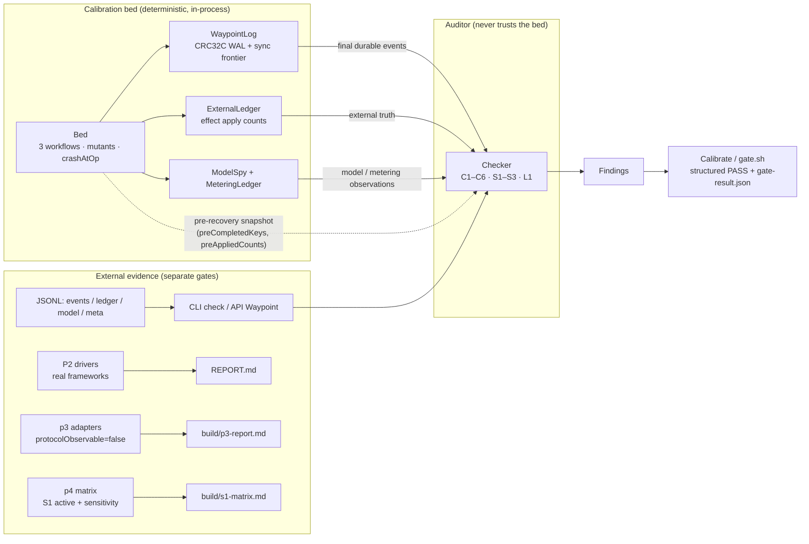
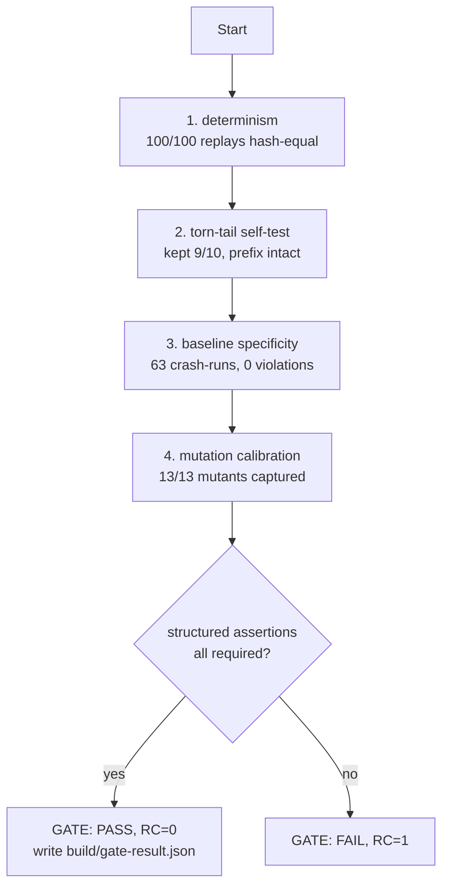

# Architecture

Status: v0.1.0. English summary: [`README.md`](../README.md). Chinese front page: [`README.zh-CN.md`](../README.zh-CN.md).

Waypoint is a research and verification tool, not a production runtime component. It asks one question: when an agent or workflow runtime crashes and resumes, does its durable log satisfy the recovery properties it claims? To answer that without trusting the runtime under test, the work is done in a fixed order: formalize the contracts, show the checker can catch known violations with mutation calibration, then test third-party frameworks.

## 1. Component map

| Component | File | Responsibility |
|---|---|---|
| Durable log | `src/main/java/waypoint/WaypointLog.java` | CRC32C-framed append-only WAL over an in-memory disk; sync boundary; torn-tail truncation; durable-prefix parsing |
| Event model | `src/main/java/waypoint/Model.java` | Explicit-schema events (`schemaVersion`, text encoding, no Java serialization), external ledger (`ExternalLedger`), metering ledger, model spy (*did the runtime call the model again?*), canonical trace/hash helpers |
| Calibration bed | `src/main/java/waypoint/Bed.java` | Deterministic mock runtime: 3 workflows (`W1_ORDER`, `W2_STREAM`, `W3_FORK`) × mutant switches × deterministic crash points `k`; UNKNOWN/reconcile/lease protocol; recovery modes (`FULL`, `LEASE_ONLY`, `SECOND_RESUMER`, `CONTINUE`) |
| Checker | `src/main/java/waypoint/Checker.java` | Contract auditor. Consumes one `Checker.RunResult` (final durable log + external ground truth + observability flags) and emits findings. Never trusts the bed's own claims |
| Gate | `src/main/java/waypoint/Calibrate.java`, `gate.sh` | Determinism self-test → torn-tail self-test → baseline specificity sweep → mutation calibration → structured PASS/FAIL + `build/gate-result.json` |
| CLI | `src/main/java/waypoint/cli/Main.java` | `calibrate`, `check --events/--ledger/--model/--meta`, `version`, `help`; exit codes 0/1/2 |
| API facade | `src/main/java/waypoint/api/Waypoint.java` | Library entry point for embedding the checker in Java code |
| JSON codec | `src/main/java/waypoint/Json.java` | Zero-dependency JSON parse/serialize used by CLI/API (no runtime third-party deps) |
| P2 framework drivers | `p2/lab/` | langgraph4j / spring-ai-alibaba-graph / LangGraph(Python) drivers, result files, capture notes |
| P3 conformance | `p3/` | Real `waypoint.Checker` fed by adapters over two real frameworks × 4 fault forms |
| P4 S1 matrix | `p4/` | Cancellation-boundary crash matrix on the calibration bed + real-LLM SSE byte-prefix smoke |

## 2. Data flow

The checker reads inputs that come from outside the runtime under test. The external ledger records side effects that actually happened, the model spy records whether the model was called again, and the pre-recovery snapshot comes from the adapter. A runtime cannot derive these from its own claims, and that is what makes a clean run meaningful.

## 3. Crash model

| Concept | Implementation | Consequence |
|---|---|---|
| sync boundary | every event written by `Wal` is `append`ed, and `sync()` advances the durable frontier | the log has two regions: durable prefix and in-memory unsynced tail |
| crash | deterministic injection at operation index `k` (`Bed.Config.crashAtOp`); recovery starts by `discardUnsynced()` | anything not synced before the crash is **lost**, exactly like a process kill with an unsynced page cache |
| torn tail | `MemoryDisk.corruptLastDurableForSelfTest()` + `Wal.reload()` truncates at the first bad frame | a half-written last record cannot be silently accepted; subsequent appends go after the last valid record |
| recovery | fresh `Wal` over the durable prefix; `appended = live.size()` (record indices continue, never restart at 0) | recovery is deterministic and repeatable; `RUN_COMPLETED` is idempotent |
| not simulated | power loss (`fsync` loss, page-cache reordering), real OS page cache, network, multi-node | stated explicitly in `README.md` limitations; do not read "process-crash safe" as "power-loss safe" |

L1 findings cover auxiliary log integrity: a step completed twice, a completion without a start, a second `RUN_COMPLETED`. L1 is not a 10th contract. It checks the log's own consistency, and a healthy baseline should produce zero L1 findings.

## 4. Contract to checker mapping

| Contract | Meaning (short) | What the checker consumes | Observable on an external adapter? |
|---|---|---|---|
| C1 | prefix continuation: no re-run of completed steps, no skipping of unfinished steps | `preCompletedKeys`, external ledger deltas, `expectedSteps`, trace | yes (needs external ledger + structured step IDs) |
| C2 | effect exactly-once under an idempotency key; `STEP_STARTED` must be durable before the effect | `ExternalLedger` counts + `ApplyRecord(startedIdx, frontierAtApply)` | **partially**: a framework that does not expose record indices cannot prove the ordering half (adapters must set `protocolObservable=false`) |
| C3 | fork determinism: sibling runs from one checkpoint have the same canonical trace | `childEvents0/1` (or legacy trace hashes); checker computes canonical traces itself | yes if the adapter can export both child event streams |
| C4 | checkpoint validity: every `COMPLETED` in a snapshot has a matching `STEP_COMPLETED` in the log prefix | `CHECKPOINT` events (supports `;`-separated multi-entry snapshots) + prefix index | **partially**: needs checkpoint snapshots with step IDs; some frameworks expose only opaque state |
| C5 | consume-once under competing resume; lease holder must be the only executor | `twoResumers`, `LEASED(path, owner)` events, `ApplyRecord.executor` | yes with executor/lease evidence; otherwise reported `unobservable` (not "clean") |
| C6 | recovery determinism: repeated recovery hashes equal; step identities stable across schedule orders | `replayHashes` (≥2), `orderTraces` (≥2) | yes if the adapter can run the same log twice and export hashes/traces |
| S1 | stream prefix and cancellation boundary: persisted chunks == configured K; replay emits exactly K; no upstream call after cancel | `CHUNK`/`CANCELLED`, `configuredCancelAt`, `replayChunksEmitted`, model spy | yes for runtimes that expose a replay path |
| S2 | compaction provenance: durable summary means no re-summarize on replay; provenance traceable | `COMPACTION` event, model spy delta | yes if compaction is a discrete step |
| S3 | metering consistency: replay adds no new metering entries; interruption classes ∈ {COMPLETED, ESTIMATED, UNKNOWN} | `MeteringLedger` pre/final counts, `interruptionKinds` | conditional (reference implementation/adapter) |
| L1 | log integrity (helper, not a contract): duplicate completion, completion without start, duplicate `RUN_COMPLETED` | whole event stream | yes |

Adapters must declare what they cannot observe through `RunResult.unobservable` or `protocolObservable=false`. An unobservable check is reported as unobservable and is not counted as a pass. That distinction separates "the framework passed" from "the property could not be checked here".

## 5. Evidence grading

| Grade | Evidence type | Where | What it can support |
|---|---|---|---|
| A, real process death | `SIGKILL` (exit 137) of the driver process, side effect `fsync`ed before the kill | `p2/lab/langgraph_sigkill_driver.py`, `lg_concurrent_resume.py` | at-least-once re-execution and concurrent-resume claims for LangGraph (Python) |
| A−, real concurrent processes | two real processes resume the same run simultaneously | `p2/lab/lg_concurrent_resume.py` | consume-once failure under true concurrency (one framework) |
| B, in-process crash | deterministic `RuntimeException` crash injection; unsynced tail discarded | Java P2 drivers, P3 cells, P4 matrix | memory-side equivalence of a process crash; not page-cache/power-loss semantics |
| C, adapter observations | real framework state read through public APIs; some check halves unobservable | `p3/` (`protocolObservable=false`, synthetic `ApplyRecord` marked in the report) | cross-framework behavioral comparison, with explicit coverage denominators |
| D, mock property tests | deterministic mock model/compaction; property-style matrix | gate, P4 S1/S2 cells | checker/engine properties, not real-model behavior |
| D+, real captured bytes | real model SSE capture, byte-prefix persistence round-trip only | `p2/lab/real_llm_sse.txt` + `p4` smoke | that real stream bytes survive fsync round-trip; not recovery-engine behavior |

Evidence files are tracked for every P2 finding; see the mapping table in [`p2/REPORT.md`](../p2/REPORT.md).

## 6. Gate pipeline

PASS is a structured numeric assertion, not a text match. Determinism must be `100/100`, torn-tail must survive 9 of 10 with an intact prefix, the healthy baseline must be `63` runs with `0` violations, and all mutants must be captured (current total in `docs/mutations.md`). Every formatted number uses `Locale.ROOT`, so the verdict does not depend on the host locale. 5 degenerate variants of the result serve as negative controls and must all yield `RC=1`.

## 7. Related documents

- `docs/contracts.md` for the 9 contracts and L1, with implementation status.
- `docs/mutations.md` for the mutant catalogue and the calibration arithmetic.
- `docs/reproducibility.md` for the environment matrix, exact commands, expected outputs and prerequisites.
- `docs/adapter-guide.md` for feeding your own runtime's logs into the checker.
- `docs/faq.md` for gaps vs violations, what 63 and 188 mean, and other common questions.
